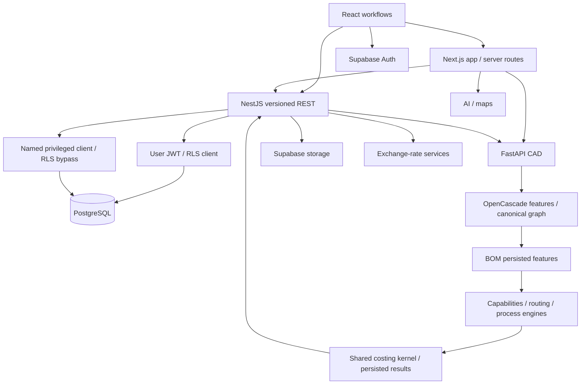

# Runtime and dependency map

**Three runtimes share Supabase and manufacturing contracts; deployed topology is unverified.**

## Current data flows

**Each public runtime and direct database access path needs its own enforcement.**

| Entry | Code / enforcement |
|---|---|
| pages/session refresh | `app/`, `proxy.ts`, `lib/supabase/client.ts`; refresh is not server-route auth |
| browser REST | `lib/api/`, `backend/src/main.ts`; URI versioning, CORS, validation, auth/log/response interceptors |
| Nest module graph | `backend/src/app.module.ts`; global auth/throttler, per-controller org guard |
| database clients | `common/supabase/supabase.service.ts`, request-auth context; user JWT vs named privileged authority |
| signed-file proxy | `app/api/file-proxy/route.ts`; direct signed URL or backend item lookup, streaming response |
| CAD | `app/api/cad/route.ts`, `cad-engine/main.py`; server key, file validation, temp disk, rate limits/geometry compute |
| auxiliary Python routes | drawing/copilot routers; separate auth decorators need audit |
| direct database | Supabase PostgREST, RLS/grants/views/RPCs; bypasses Nest |

## Representative manufacturing path

**Reference data supplies capabilities/assumptions, and Sheet Metal, machining and molding are all active.**

- UI BOM/file upload reaches backend storage/CAD services; CAD produces geometry/feature graph, BOM persists inputs/results, capabilities/routing select process/machine, shared kernel composes costs, API returns results to UI.
- `backend/src/modules/bom-items/` orchestrates material/FX/machine/labor and registered engines. DFM authority is `dfm-scoring.service.ts`; UI must not invent a second verdict.
- Generated vocabulary: `cad-engine/scripts/build_reference_features.py` reads catalogs, emits JSON/TypeScript. Never hand-edit outputs or invent missing source data.
- Large BOM orchestrator and legacy feature representation are documented coupling risks, not grounds for formula rewrites. Cross-service units/tolerances and manufacturing assumptions need real scenario verification.

## Build, data and deployment inputs

**npm and conda/Docker are separate reproducibility boundaries.**

- Independent root/backend npm lockfiles; no coordinating workspace manifest. Node 20 declared by CI, Node 22 used locally.
- CAD requirements pin web dependencies but range some AI/PDF/geometry versions; conda Dockerfile supplies pythonocc. Python runtime unavailable locally.
- `memory/` contains tracked manufacturing references used by tests, generators and staging migrations; exact directory casing matters on Linux.
- Three SQL trees conflict historically; existing delivery/QC migration design requires live introspection before changes.
- Docker/Compose/Railway/Render configs are candidates, not proof every queue/cache/service is deployed.

## Active / legacy classification

**No uncertain code or deployment input is removed.**

| Candidate | Classification |
|---|---|
| Next routes, Nest module imports, FastAPI app/routers | active entry points |
| references, generated vocabulary, migrations | active inputs/history |
| delivery/QC schema variants | conflicting historical definitions; live state unknown |
| secondary DB/Redis packages | inventory reports unused backend imports; removal deferred pending script/deploy review |
| deployment manifests, legacy feature graph/fallbacks | uncertain compatibility/runtime usage; preserve |

See [audit](architecture-audit.md) and [issue register](issue-register.md). No files, dependencies, routes or migrations removed; no deployment/data writes performed.
