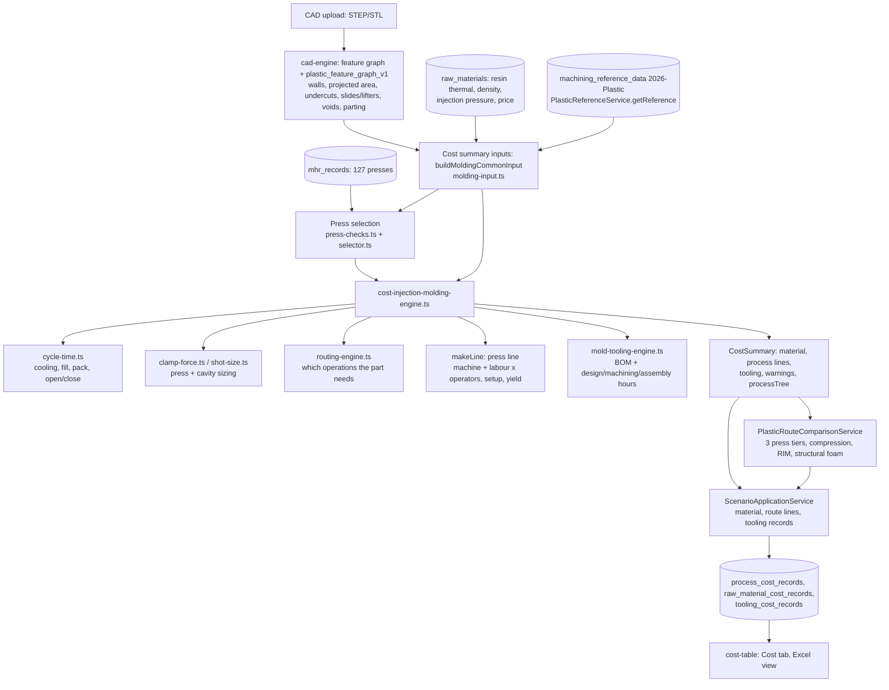

# Plastic Modeling: audit, architecture specification and implementation plan

Status: **for review. No cost calculation is changed by this document or its PR.**
Evidence date: 2026-11-07. Repo state: `main` after #234 (labour charge #230, tooling records #231, split columns #233).
Reproduce the numbers: `node backend/scripts/plastic-reference-traceability.cjs` (writes `traceability-matrix.csv`, 575 rows).

Validation vocabulary used throughout (the same three states the engine must expose, section 7):

| State | Meaning |
|---|---|
| **VALIDATED** | The value or rule comes from staged `memory/` data, or from a machine/material record, and is read as stated. |
| **ASSUMED** | A literature rule, a code constant or an engineering simplification with no source in `memory/`. Disclosed, never silent. Needs expert approval. |
| **UNSUPPORTED** | Not modelled. The data may exist, but no authoritative formula does. The quote says so and carries a gap, never a zero. |

---

## 1. Inventory of `memory/`

1,218 files in 35 folders (1,150 csv, 25 png, 19 md, 15 json, 6 xlsx, 1 each of pdf, docx, txt).

| Folder | Files | Plastic relevance |
|---|---|---|
| `Plastic Modeling/` | 89 | **The reference set**: `variables` (303), `lookup` (38 tables), `machine` (4 files, 127 machines), `materials_final.csv` (109 rows), `process` (92 catalog operations + settings + tool materials), `wage_grade_associations.csv`, `wagegrade.png` |
| `2 Mold Molding/` | 3 | Generic variables/operations (assembly-style); no molding formulas. Duplicates part of `Plastic Modeling/variables`. |
| `Assembly molding/`, `Assembly plastic molding/` | 25, 27 | Assembly-molding variants; not read by the engine; out of scope unless the product adds those processes. |
| `Sheet Plastic/`, `Roto & blow molding/`, `Composites/`, `Rapid prototyping/`, `Additive Manufacturing/` | 26, 17, 16, 12, 26 | Other plastic processes. Not part of injection / compression / RIM / structural foam. |
| `Standards/` | 2 | ISO 286 tolerances. Not used for molding. |
| `Sheetmetal/` (17 `.md` specs, 1 `.docx`; the two `.xlsx` calculator workbooks are in `database/`) | 148 | **The only folder with written specifications.** Sheet metal has algorithm documents; **plastic has none.** |
| `Countries data/`, `database/`, others | | Location rates and the sheet-metal calculator workbooks. |

**Finding 1 (decisive for the plan): `memory/Plastic Modeling/` contains data, not formulas.** No specification, workbook or standard describes how a mold, a cycle or a quote is computed. The only prose is the `notes` column of the variables (e.g. "Used in the Compression Molding process routing"). Every formula in the engine today was therefore written by engineers from literature or from those one-line notes. Section 6 classifies each.

Staged data (all of it is in the database; nothing is missing at staging level): `machining_reference_data`, `source_version = '2026-Plastic'` (migration 823): 303 variables, 40 lookup tables, 92 operations, 6 processes, 6 wage grades. Machines are staged into `mhr_records` (127 plastic presses); materials into `raw_materials`.

## 2. Datasets, and what reaches the engine

Generated by `plastic-reference-traceability.cjs` (a name counts as read when it appears in the code that prices or selects machines for plastic parts; it proves a value is loaded, not that it is used correctly).

| Dataset | Items | Read | Not read |
|---|---|---|---|
| Variables | 303 | 29 | 274 |
| Lookup tables | 38 | 12 | 26 |
| Machine columns (4 press types) | 138 (excl. 23 identity) | 103 | 38 (the same ~12 per press type) |
| Material columns | 27 (excl. 7 identity) | 15 | 12 |
| Process settings (USA) | 23 | 5 | 18 |
| Tool materials | 13 | 2 | 11 |

Scope of the variables, from their own notes: **71 say they serve Compression Molding** (the whole `cm*` mold-build model), 11 injection, 4 structural foam, 2 RIM, **215 do not say**. Only 4 of the 71 compression variables and 4 of the 11 injection ones are read.

Tables read: `tblSpiType`, `tblToolLife`, `layoutNumCav`, `injectionTimeAdjustmentFactors`, `tblStandardMoldBaseSizes`, `tblRunnerCalculationCoefficients`, and the six `cm*` tool tables (`cmStandardToolingComponents`, `cmToolAssemblyTimes`, `cmToolAssemblyNumOperators`, `cmMoldBaseDesignHours`, `cmToolMachiningRates`, `cmToolMachiningSetups`).
Tables **not read**: `tblSlideSizes`, `tblStandardWaterLineSizes`, `cavityTextures`, `cmToolTexture`, `tblToolCoating`, `tblMoldBaseDesignHrs`, `tblHrsPerSqInch{Simple,Average,Complex}`, `tblEdgeMoldBorderX/Y`, `tblCavityPlateDepthBorder`, `tblCorePlateDepthBorder`, `partHandlingTimes`, `materialHandling`, `plasticizingRateByClampForce`, `finishingHrsPerSqMeter`, `foamingAgents`, `tblTolerances`, `tblGrillInsertTypes`, `tblDTCLimits`, `SPIFinishes`, `adviceRules`, `manufacturabilitySeverity`, `validationDisplayControls`, `cmColorantMaterials`.
Settings **not read**: edm/gun-drill/tryout rates, heat-treat and stress-relief $/kg, mark-up (6.0), SG&A (12.77), region multiplier, duty, freight, tolerance factors, `moldMin`, default tool material (AISI P20, $1.86/kg).

Full per-item list: `traceability-matrix.csv`.

## 3. The costing flow today, CAD to quote



## 4. Target architecture: seven responsibilities, mapped to existing code

No new services, no new deployables. The seven engines are **modules with an explicit interface inside the existing `costing/plastic-molding/` folder**, each returning an auditable result (section 7). Today the responsibilities exist but are interleaved in one 680-line function (`computeInjectionMoldedCostSummary`).

| Responsibility | Today lives in | Change in the plan |
|---|---|---|
| Material Cost Engine | material block of the cost engine (`shotWeight × price / yield`); `MaterialResolutionService`; `shot-size.ts` | Extract; make runner allowance and yield explicit inputs |
| Injection Cycle-Time Engine | `cycle-time.ts` (already isolated, pure) | Keep; add formula ids and status per step |
| Machine Cost Engine | `press-checks.ts`, `machine-selector-im.ts`, `makeLine` | Extract `makeLine` rate math; fix staged `operators` (D-1) |
| Mold Design and Tooling Cost Engine | `mold-tooling-engine.ts` (BOM + hours only) | Grow plate-by-plate (section 8), only against an approved spec |
| Secondary Operations Engine | `routing-engine.ts` + `process-tree.ts` (routes), warnings only for cost | Cost each operation only when its formula is approved |
| Cost Aggregation Engine | totals in the cost engine; `PlasticRouteComparisonService`; `route-tooling.ts`; `cost-table.ts` | One aggregation over `PricedRoute` (already the plan) |
| Cost Explainability and Validation Layer | `calculationTrace`, `warnings[]`, `findRouteDataGaps` | Replace free-text warnings with the `CalcStep` record (section 7) |

## 5. Source-to-engine traceability: what is used and how

The engine's real inputs, by source (VALIDATED unless marked):

- **Variables read (29):** clamp model (`clampForceSafetyFactor`, flow thresholds, `minimumPercentClampForce*`, runner pressure reductions, `minInjectionPressure`), `shotSizeSafetyFactor`, cycle (`cycleTimeAdjustmentFactor`, `defaultMoldTemperatureIncrease`, `defaultRunnerSystem`, `defaultNumCavities`, `defaultNumberOfGatesPerCavity`), `defaultToolLife`, `GPPSMeltTemperature`, feature rules (`maxNoCoreInsertDiameter`, draw-direction epsilons).
- **Machine record columns read:** clamp force, shot size (GPPS g), tie bars, mold height min/max, dry cycle, injection rate, setup time, good-part yield, machine rate (`total_machine_hour_rate`), labour rate, operators, direct/indirect overhead.
- **Material columns read:** densities, temperatures, specific heat, conductivity, injection pressure max, flow length ratio, cure time, process compatibility flags.
- **Tooling tables read:** the six `cm*` tables and `tblSpiType`, `tblToolLife`, plus USA toolroom rates (design, machining, assembly).

## 6. Formula register

| ID | Calculation | Authority | State | Code | Notes |
|---|---|---|---|---|---|
| F-01 | Clamp force: projected area x cavities x cavity pressure x safety factor; cavity pressure = adjusted injection pressure x %clamp by flow class | Parameters: staged variables. Structure: variable notes name `adjustedInjectionPressure`; **no formula document** | Parameters VALIDATED, structure **ASSUMED** | `clamp-force.ts` | |
| F-02 | Shot size in GPPS grams = shot mass x (GPPS melt density / material melt density) x safety factor | Press data is rated in GPPS g (`limits.shotSizeGppsG`); conversion is the same barrel volume | VALIDATED | `shot-size.ts` | |
| F-03 | Runner/sprue allowance: cold 8 %, hot 1 % of part mass | **None.** Code header: "the one figure here without a reference source" | **ASSUMED** | `shot-size.ts` | Affects material cost and shot size |
| F-04 | Cooling time (Menges): `t = s²/(π²α) · ln((4/π)(Tm−Tw)/(Te−Tw))`, `α = k/(ρ·cp)` | Polymer engineering literature (Menges). Inputs from the material record | Inputs VALIDATED, formula **ASSUMED** (literature) | `cycle-time.ts` | |
| F-05 | Fill time = shot melt volume / press injection rate x fill factors (cavities, gates) | Press rate: machine record. Factors: staged `injectionTimeAdjustmentFactors` | VALIDATED, see D-6 | `cycle-time.ts` | `injectionRateMultiplier` (0.25) is staged and unread |
| F-06 | Pack/hold = max(2 s, 0.35 x cooling) | Menges gate-freeze rule. "The reference data holds no hold-time value" | **ASSUMED** | `cycle-time.ts` | |
| F-07 | Mold open/close = press dry cycle | Euromap 6, machine record `time.dryCycleTimeS` | VALIDATED | `cycle-time.ts` | |
| F-08 | Total cycle = (fill + pack + cool + open/close) x `cycleTimeAdjustmentFactor` | Staged variable | VALIDATED | `cycle-time.ts` | Ejector travel, plasticizing, part and material handling **not modelled** |
| F-09 | LSR cure (Arrhenius), constants from Ossipov et al. 2002 | Literature | **ASSUMED** | `cycle-time.ts` | LSR only |
| F-10 | Cavity count: reference layouts (`layoutNumCav`), default 1, user override | Staged | VALIDATED | cost engine | |
| F-11 | Press capability: clamp, shot, tie-bar, daylight | Machine record limits. Tool height = longest side + 100 mm | Limits VALIDATED, tool height **ASSUMED** | `press-checks.ts` | |
| F-12 | Operation cost per part = (machine rate + labour rate x operators) x (cycle + setup / batch) | Machine record (rates, setup, operators) | Rates VALIDATED; **operators wrong, see D-1** | `makeLine` | Added by #230 |
| F-13 | Good-part yield: cost / yield | Machine record `yields.goodPartYield` | VALIDATED | cost engine | |
| F-14 | Material cost = shot weight / yield x price per kg | Price: `raw_materials` regional columns | Structure VALIDATED; price source see D-5 | cost engine | |
| F-15 | SPI mold class from lifetime shots, parting complexity, undercuts | `tblSpiType` ratings; complexity bump is a code rule | Ratings VALIDATED, bump **ASSUMED** | `recommendMoldClass` | **Class does not change the tooling cost (D-4)** |
| F-16 | Mold tooling = purchased components + design hours (by area) + plate machining + assembly hours, priced at USA toolroom rates | Staged `cm*` tables and settings | Tables VALIDATED; **scope ASSUMED (D-8)**; area = projected area x cavities with no margin (**ASSUMED**) | `mold-tooling-engine.ts` | Excludes steel, EDM, texture, etc. |
| F-17 | Molds required = ceil(lifetime shots / tool life); cost x molds | `tblToolLife` | Tool life VALIDATED, "a replacement mold costs the full price" **ASSUMED** | cost engine | |
| F-18 | Tooling per part = investment / (annual volume x life) | Scenario inputs | VALIDATED | cost engine, `route-tooling.ts` | Persisted as a tooling record since #231 |

## 7. Explainability and validation layer: specification

Every calculation returns one record, and the quote carries the list. This extends `calculationTrace` (which today lacks ids, versions and status); it adds no service.

```ts
type ValidationState = 'VALIDATED' | 'ASSUMED' | 'UNSUPPORTED';

interface CalcStep {
  formulaId: string;            // 'F-04'
  formulaVersion: number;       // bumped on any change to the formula or its constants
  label: string;                // 'Cooling time'
  inputs: Record<string, { value: number | string | null; unit: string; source: string }>;
  appliedRates?: Record<string, { value: number; unit: string; source: string }>;
  intermediates?: Record<string, number>;
  assumptions: string[];        // empty for VALIDATED
  state: ValidationState;
  amount: number | null;        // null (never 0) when UNSUPPORTED
  unit: string;
  referenceSource: string;      // 'memory/Plastic Modeling/variables: cycleTimeAdjustmentFactor' or 'Menges (literature)'
}
```

- A quote's overall state is the weakest state among its steps. The Cost tab shows it and lists the ASSUMED and UNSUPPORTED steps.
- **Reproducibility:** each saved calculation stores `{referenceDataset: '2026-Plastic', datasetHash, engineVersion, formulaVersions, inputs}` in `calculation_breakdown` (the column exists). A saved quote can be re-derived from the snapshot.
- UNSUPPORTED replaces the current "no sourced data exists" warning text; it already maps onto `DataGap` (#234 made those reasons truthful).

## 8. Gap and defect register

### Defects (the system does something that conflicts with its own data or comments)

| ID | Finding | Evidence | Effect | Fix (needs approval) |
|---|---|---|---|---|
| **D-1** | **Fractional operators lost in staging.** Source: all 81 injection and all 21 structural-foam presses have `numberOfOperators = 0.5`. Staged `mhr_records.operators` is `smallint`, so 0.5 became 1. | Source CSV vs `mhr_records` (81/81 injection, 21/21 foam differ). Kawaguchi KM80: source 0.5, database 1. | **The labour charged since #230 is 2x the source for 102 presses** (Back cover: cycle labour $0.092 would be $0.046; the Injection Molding line $0.61 would be $0.43). | Make the column `numeric(4,2)`, restage, add a source-vs-database parity test over all 127 presses. Lowers injection and foam prices. |
| D-2 | `overhead_multiplier`: source `0.0` (injection, foam), staged `1.000`. Compression: 15 of 23 differ. RIM: 2 of 2. | Same comparison | Not read by the engine today (machine rate already equals direct + indirect overhead: 8.19 + 14.5 = 22.69), so no price effect now; a latent conflict | Decide the meaning; then stage faithfully |
| D-3 | `mold-tooling-engine.ts` says a "+35 % per additional cavity" heuristic "is retained". **The code has no per-cavity scaling**: a 1-cavity and an 8-cavity mold cost the same. | `grep` finds the comment only | Multi-cavity tooling is understated | Remove the stale comment and decide a rule (UNSUPPORTED until specified) |
| D-4 | SPI mold class is computed and shown but never enters the tooling cost. | `computeMoldToolingCost` has no class input | Class 101 and Class 105 molds cost the same | Specify class-dependent build cost, or stop implying it matters |
| D-5 | Two material price sources: `materials_final.csv` `cost.unitCostUsdPerKg` is unread; price comes from `raw_materials` regional columns. | Traceability matrix | Possible disagreement | Reconcile (a parity test) |
| D-6 | `injectionRateMultiplier = .25` ("multiplier used to downgrade the machine injection rate") is staged and unread. | Variables | If applied, fill time grows; magnitude unknown | Needs the intended formula (is it `rate x 0.25` or `rate x (1 - 0.25)`?) |
| D-7 | Legacy `raw_materials` rows (e.g. "Generic ABS, 30% Glass Filled") lack injection data that the dataset row ("Generic ABS, 30% Glass") has. | Known; picker filters them | Parts costed on the legacy grade cannot be molded | Retire or merge the legacy rows |
| D-8 | The mold tool tables are named `cm*` and their variables say "Compression Molding"; the injection engine reuses them. The previous engineers declined to reuse the allowance variables for that reason, but did reuse the component, assembly and design-hour tables. | Variables notes; `mold-tooling-engine.ts` header | Possible misattribution of a compression mold model to injection | Expert confirmation |

### Missing functionality (data staged; no authoritative formula in `memory/`)

All are **UNSUPPORTED** until a specification exists. "Data" lists what is staged.

| ID | Item | Data staged | Formula source |
|---|---|---|---|
| G-01 | Mold base selection and plate-by-plate steel costing | `tblStandardMoldBaseSizes`, tool material price/density (P20 $1.86/kg, 7,850 kg/m3), `cm*PlateMinThickness`, `tblCavity/CorePlateDepthBorder`, edge borders | None |
| G-02 | Core and cavity blocks | plate-depth tables, `cmToolMachiningRates`, EDM rates | None |
| G-03 | Slides and lifters | `tblSlideSizes`, `slide*/lifter*` variables, `costPerHydraulicEjector`, `slideCycleRate` | None (the engine prices only the staged hardware rows) |
| G-04 | EDM and heat treatment | `edmRateUsdPerHr`, EDM material $/in3, `heatTreatRateUsdPerKg`, stress relief, `cutterPathHrsPerInsert` | None |
| G-05 | Mold texture | `cavityTextures`, `cmToolTexture`, `toolBlastingRate`, `toolChemicalEtchingRate`, `toolMaskingRate`, `toolDryingTime` | None |
| G-06 | Cooling and water lines | `tblStandardWaterLineSizes`, `defaultWaterLineDiameter`, `water*Cost` | None |
| G-07 | Inserts, unscrewing | `insertInstallRate`, `cmInsertManualLoadingTime`, `defaultInsertCost`, `costPerUnscrewingMechanism` | None |
| G-08 | Tool assembly, ejector system, sprue and hot drops, try-out | `cmToolAssembly*` (partly used), `ejector*`, `sprue*`, `costPerStandardHotDrop`, `tryoutRateUsdPerHr` | Partly (components and hours) |
| G-09 | Handling in the cycle, setup scrap, plasticizing limit | `partHandlingTimes`, `materialHandling`, `scrapTimeInMinutes_*`, `plasticizingRateByClampForce`, machine `plasticizingRateGppsGPerS` | None |
| G-10 | Period costs: indirect overhead, SG&A, margin | settings `sGandARate` 12.77, `markUpRate` 6.0, machine indirect overhead | None (the Excel view declares these "not modelled") |
| G-11 | Material drying, visual inspection, ultrasonic welding, cure oven, LSR dosing | None | None |
| G-12 | Toolroom rates outside the USA | `memory/` has USA settings only | None; mold labour is unpriced elsewhere (already warned) |
| G-13 | Independently verified benchmarks | **None exist for plastic** | Needed from the product owner |

## 9. Prioritised roadmap and PR-by-PR plan

Rule for every PR: small, independently reviewable, regression suite green, evidence in the description, **no price change without a before/after table and approval**.

| # | PR | Prices change? | Needs approval first |
|---|---|---|---|
| P0 | This audit, spec and traceability script | No | Review of this document |
| P1 | **D-1:** `operators` numeric, restage the 127 presses, source-vs-database parity test (all numeric machine columns) | **Yes, down (labour halves for 102 presses)** | **Yes** |
| P2 | `CalcStep` type and formula ids; retrofit `cycle-time`, `clamp-force`, `shot-size`, line cost; quote shows its weakest state | No | Section 7 |
| P3 | Calculation snapshot: dataset hash, engine and formula versions in `calculation_breakdown` | No | |
| P4 | Golden benchmark harness (section 10) with the existing worked examples, tolerance bands, every intermediate asserted | No | |
| P5 | D-3, D-4, D-5, D-7: remove the stale comment, expose SPI class as informational, reconcile material prices, retire legacy rows | No (parity tests) | D-3/D-4 rules |
| P6 | Mold-base selection and plate-by-plate steel (G-01) | Yes, up | **Specification** |
| P7 | Core and cavity (G-02) | Yes | Specification |
| P8 | Slides and lifters (G-03) | Yes | Specification |
| P9 | EDM and heat treatment (G-04) | Yes | Specification |
| P10 | Texture (G-05) | Yes | Specification |
| P11 | Cooling and water lines (G-06) | Yes | Specification |
| P12 | Inserts and unscrewing, conditional on the part (G-07) | Yes, only for parts that need them | Specification |
| P13 | Assembly, ejector, sprue, try-out (G-08) | Yes | Specification |
| P14 | Handling, setup scrap, plasticizing (G-09), cycle changes | Yes | Specification |
| P15 | Period costs (G-10) | Yes | Specification |

P6-P15 are conditional operations: each is applied only when the recognised features and the mold design require it (a part with no undercut pays for no slide), and each one is a `CalcStep` with its state. Where no specification is supplied, a **provisional model is proposed in the PR, clearly labelled ASSUMED, for expert approval** and is not enabled by default.

## 10. Golden benchmark suite

State today: the repo has worked examples (ABS part in `plastic-molding-accuracy.spec.ts`, PA66 in `plastic-molding-integration.spec.ts`, press-capability parity over 81 presses). They are hand-worked by the engineers, **not independently verified**; no reference quote exists for a plastic part (G-13).

Plan:
1. Fixture format: part facts + scenario + expected value **for every intermediate** (clamp, shot, cooling, fill, cycle, line, material, mold hours, mold cost, per part) with the formula id.
2. Cases: one per press type, one thin-wall, one thick-wall, one multi-cavity, one with slides, one LSR, one non-USA location (mold labour unpriced), one material with missing data (every UNSUPPORTED path).
3. Each expected value cites its derivation (hand calculation sheet in the fixture directory) so a reviewer can verify it independently.
4. Regression rule: a change to an expected value requires the PR to state the formula id and its approval.
5. **Needed from you:** two or three reference quotes for plastic parts from the original tool (for example the Back cover and the Terminal box cover), with their intermediate values. Without them, "validated against independently verified examples" is not achievable for plastic, and the suite can only prove consistency, not correctness.

## 11. Decisions requested

1. **D-1 (priority):** approve the operators fix (P1). It lowers every injection and structural-foam labour charge by half and corrects what #230 introduced.
2. Provide the formula specification (or reference workbook) for the mold build (G-01 to G-08), or approve provisional models proposed per PR.
3. Provide reference quotes for the golden suite (G-13).
4. Confirm whether the `cm*` mold tables apply to injection molds (D-8) and the meaning of `injectionRateMultiplier` (D-6) and `overheadMultiplier` (D-2).
5. Confirm scope: injection, compression, RIM and structural foam only (the other plastic folders are out of this plan).
